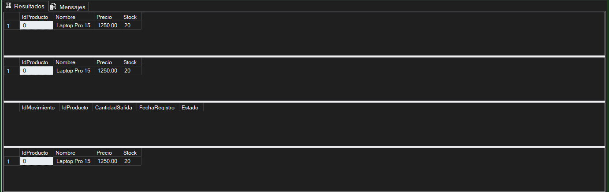

# EP_03_Programacion_base_datos

📋 Contenido de las Actividades

---
## Actividad 1: Identificación del Proceso a Automatizar

### Proyecto: NovaMarket - Sistema de Gestión de Inventario y Ventas
---
### Contexto

NovaMarket es una organización que administra información de clientes, productos y operaciones mediante una base de datos en Microsoft SQL Server. Los usuarios realizan constantemente tareas de mantenimiento relacionadas con el registro de productos y la actualización de existencias, por lo que se requiere trasladar parte de la lógica de negocio al servidor para mejorar la consistencia, seguridad y reutilización de los procesos.

## Proceso Seleccionado

### Mantenimiento de Productos

El proceso seleccionado consiste en gestionar el catálogo de productos mediante dos operaciones principales:

1. Registro de nuevos productos.
2. Actualización del stock de productos existentes.

Estas operaciones son realizadas frecuentemente por los usuarios del sistema y requieren validaciones que garanticen la integridad de los datos almacenados.

---

## Entradas y Salidas

## Proceso 1: Registrar Producto

### Entradas

- Nombre del producto
- Precio del producto
- Stock inicial

### Salidas

- Identificador (ID) generado automáticamente para el producto

### Reglas de Negocio

- El precio debe ser mayor que cero.
- El stock inicial no puede ser negativo.

---

## Proceso 2: Actualizar Stock

### Entradas

- ID del producto
- Nuevo stock

### Salidas

- Código de resultado de la operación

### Reglas de Negocio

- El producto debe existir.
- El nuevo stock no puede ser negativo.

### Códigos de Retorno

| Código | Descripción |
|----------|-------------|
| 0 | Actualización exitosa |
| -1 | El producto no existe |
| -2 | El stock es inválido |

---

# Pseudocódigo del Proceso

## Registro de Producto

```text
Inicio

Recibir Nombre
Recibir Precio
Recibir Stock

Si Precio <= 0
    Mostrar error
    Finalizar
Fin Si

Si Stock < 0
    Mostrar error
    Finalizar
Fin Si

Insertar producto en la base de datos

Obtener ID generado

Devolver ID

Fin
```

## Actualización de Stock

```text
Inicio

Recibir IdProducto
Recibir NuevoStock

Si el producto no existe
    Retornar -1
Fin Si

Si NuevoStock < 0
    Retornar -2
Fin Si

Actualizar Stock

Retornar 0

Fin
```

---

# Relación con la Arquitectura Cliente/Servidor

```text
+---------------------------+
|          CLIENTE          |
|  Aplicación del Usuario   |
+------------+--------------+
             |
             | Ejecuta
             | Procedimientos
             V
+---------------------------+
|         SERVIDOR          |
|        SQL SERVER         |
|                           |
| sp_InsertarProducto       |
| sp_ActualizarStockProducto|
+------------+--------------+
             |
             | Acceso
             V
+---------------------------+
|      BASE DE DATOS        |
|         Productos         |
+---------------------------+
```

---

# Justificación de la Automatización

La implementación de este proceso mediante procedimientos almacenados en SQL Server ofrece las siguientes ventajas:

- Centraliza las reglas de negocio en el servidor.
- Evita duplicar validaciones en múltiples aplicaciones cliente.
- Garantiza la integridad de los datos.
- Facilita el mantenimiento del sistema.
- Reduce errores producidos por entradas incorrectas.
- Permite reutilizar la misma lógica desde diferentes aplicaciones.
- Disminuye el tráfico entre cliente y servidor al ejecutar las validaciones directamente en la base de datos.

---
## Actividad 2: Procedimientos Almacenados de Mantenimiento

**Contexto y Problema:** Operaciones de mantenimiento reutilizables sobre las tablas existentes (`Producto`), permitiendo altas y actualizaciones controladas desde el servidor.

### 1. Script T-SQL: Procedimientos Almacenados

```sql
USE NovaMarket;
GO

CREATE OR ALTER PROCEDURE sp_InsertarProducto
    @Nombre NVARCHAR(100),
    @Precio DECIMAL(10,2),
    @Stock INT,
    @NuevoId INT OUTPUT
AS
BEGIN
    SET NOCOUNT ON;
    
    IF @Precio <= 0
    BEGIN
        RAISERROR('El precio del producto debe ser mayor a cero.', 16, 1);
        RETURN;
    END;

    IF @Stock < 0
    BEGIN
        RAISERROR('El stock inicial no puede ser negativo.', 16, 1);
        RETURN;
    END;

    INSERT INTO Producto (Nombre, Precio, Stock)
    VALUES (@Nombre, @Precio, @Stock);

    SET @NuevoId = SCOPE_IDENTITY();
END;
GO

CREATE OR ALTER PROCEDURE sp_ActualizarStockProducto
    @IdProducto INT,
    @NuevoStock INT
AS
BEGIN
    SET NOCOUNT ON;

    IF NOT EXISTS (SELECT 1 FROM Producto WHERE IdProducto = @IdProducto)
    BEGIN
        RETURN -1;
    END;

    IF @NuevoStock < 0
    BEGIN
        RETURN -2;
    END;

    UPDATE Producto
    SET Stock = @NuevoStock
    WHERE IdProducto = @IdProducto;

    RETURN 0;
END;
GO
```

### 2. Casos de Prueba y Evidencias de Ejecución


```sql
DECLARE @IdGenerado INT;

EXEC sp_InsertarProducto 
    @Nombre = 'Laptop Pro 15', 
    @Precio = 1250.00, 
    @Stock = 20, 
    @NuevoId = @IdGenerado OUTPUT;

SELECT @IdGenerado AS [ID_Producto_Creado];
GO

DECLARE @ResultadoActualizacion INT;

EXEC @ResultadoActualizacion = sp_ActualizarStockProducto 
    @IdProducto = 1, 
    @NuevoStock = 18;

SELECT @ResultadoActualizacion AS [Codigo_Resultado_Retorno];
GO
```


## Actividad 03: Diseño de una operación transaccional
  ### Por Andrés Francisco Pimentel Saldaña

Contexto:
Una operación organizacional requiere que varios cambios se consideren como una unidad lógica.

Problema:
Si una parte del proceso no corresponde al resultado esperado, los cambios no deben quedar aplicados de forma parcial.

Solución y script transaccional:
Para resolver esto, primero creamos una tabla complementaria HistorialMovimientos y luego implementamos un procedimiento almacenado con una transacción explícita.

```sql
use NovaMarket;
go

--Creación de la tabla HistorialMovimientos (para la transacción)
create table HistorialMovimientos (
    IdMovimiento int identity(1,1) primary key,
    IdProducto int,
    CantidadSalida int,
    FechaRegistro datetime default getdate(),
    Estado varchar(20)
);
go


--Procedimiento almacenado con transacción explícita
create OR alter procedure sp_RegistrarSalidaInventario
    @IdProducto int,
    @CantidadSalida int
as
begin
    set nocount on;

    begin transaction;

    begin try
        if @CantidadSalida <= 0
        begin
            raiserror('La cantidad de salida debe ser mayor a cero.', 16, 1);
        end

        declare @StockActual int;
        select @StockActual = Stock from Producto 
        where IdProducto = @IdProducto;

        if @StockActual is null
        begin
            raiserror('El producto no existe.', 16, 1);
        end

        if @StockActual < @CantidadSalida
        begin
            raiserror('Stock insuficiente para realizar la operación.', 16, 1);
        end


        --Operaciones agrupadas
        update Producto 
        set Stock = Stock - @CantidadSalida 
        where IdProducto = @IdProducto;
        
        insert into HistorialMovimientos (IdProducto, CantidadSalida, Estado)
        values (@IdProducto, @CantidadSalida, 'COMPLETADO');

        commit transaction;
        print 'Transacción confirmada (COMMIT): Salida registrada exitosamente.';
    end try
    begin catch

        if @@trancount > 0
        begin
            rollback transaction;
            print 'Transacción cancelada (ROLLBACK): No se aplicaron cambios parciales.';
        end

        print 'Detalle del error: ' + error_message();
    end catch
end;
go
```

**Criterios de Confirmación y Cancelación:**
- **Confirmación (commit):** Se ejecuta únicamente si las dos operaciones lógicas (el `update` del stock y el `insert` en el historial) se completan con éxito sin arrojar errores dentro del bloque `try`.
- **Cancelación (rollback):** Se ejecuta si se activa alguna regla de negocio (como intentar registrar una cantidad negativa o solicitar más stock del existente) o si ocurre un error del servidor. El bloque `catch` intercepta el fallo, deshace cualquier cambio y protege los datos.

**Diferencia entre comportamientos transaccionales:**
- **De autoconfirmación (Autocommit):** Cada instrucción individual (como un solo `update`) se confirma o se cancela automáticamente por sí sola tras ejecutarse. No permite agrupar operaciones.
- **Implícito:** SQL Server inicia una transacción autom[atica en segundo plano al detectar comandos de modificación de datos, pero la deja abierta; obliga a emitir un comando `commit` o `rollback` para finalizarla.
- **Explícito:** Es el modelo utilizado en nuestra solución y con él definimos de forma manual y exacta dónde inicia la unidad lógica de trabajo (mediante `begin transaction`) y controla cuándo confirmarla o deshacerla según la lógica del negocio.

A continuación, adjuntaré una captura del SQL Server Management en la que se muestra que no se encontraron problemas en el código:


## Actividad 4: Pruebas Comparativas y Argumentación

**Contexto y Objetivo:** 
Verificación del comportamiento del procedimiento transaccional `sp_RegistrarSalidaInventario` bajo escenarios favorables y no favorables, asegurando que las reglas de negocio y los mecanismos de control de errores eviten corrupciones de datos.

### 1. Casos de Prueba Ejecutados

#### A. Escenario Favorable (Confirmación - COMMIT)
* **Descripción:** Se registra una salida de inventario válida sobre un producto con stock suficiente.
* **Script de Ejecución:**
  ```sql
  USE NovaMarket;
  GO

  -- Insertar producto de prueba (ID 1)
  INSERT INTO Producto (Nombre, Precio, Stock) VALUES ('Laptop Pro 15', 1250.00, 20);
  GO

  -- Ejecutar salida exitosa de 5 unidades
  EXEC sp_RegistrarSalidaInventario @IdProducto = 1, @CantidadSalida = 5;
  GO

  -- Consultar evidencias
  SELECT * FROM Producto WHERE IdProducto = 1;
  SELECT * FROM HistorialMovimientos;
  GO

  Comportamiento Observado: La transacción se ejecuta correctamente, actualizando el stock de 20 a 15 y registrando el movimiento como 'COMPLETADO'. La operación aplica un COMMIT exitoso.

B. Escenario No Favorable (Cancelación - ROLLBACK)
Descripción: Se intenta retirar una cantidad superior al stock disponible actual para validar la protección contra estados inconsistentes.

Script de Ejecución:
```sql
USE NovaMarket;
GO

-- Intentar retirar 500 unidades (supera el stock actual)
EXEC sp_RegistrarSalidaInventario @IdProducto = 1, @CantidadSalida = 500;
GO

-- Consultar estado del stock
SELECT * FROM Producto WHERE IdProducto = 1;
GO
```

Comportamiento Observado: Al detectar stock insuficiente, se activa el bloque CATCH ejecutando un ROLLBACK TRANSACTION. Se cancelan los cambios parciales y el stock se mantiene intacto.

2. Evidencias de Ejecución (Resultados de Pruebas)
A continuación se adjunta la captura de pantalla de los resultados obtenidos en SQL Server Management Studio para las pruebas comparativas:

